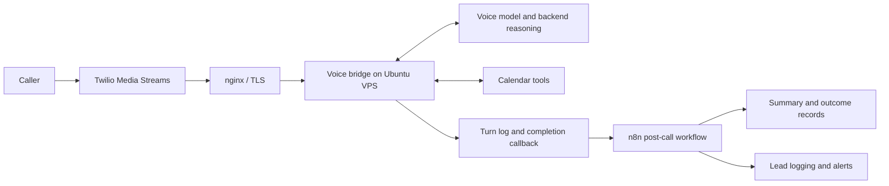

# DialHaven: operating an AI phone-receptionist system

**Travis Gadow — automation, implementation and Linux operations**

DialHaven is my own project for small-business phone answering. The system has been exercised with test and demonstration calls; this case study does not claim paying customers, production-scale traffic or an uptime SLA.

## What I own

I direct AI coding assistants for much of the bridge code. I own the system design, n8n workflow logic, deployment, test-call review and operational troubleshooting. This is hands-on implementation and operations experience, not a claim that I wrote every line unaided.

## Architecture

The bridge handles live conversation and calendar tools. n8n handles post-call processing rather than the live audio loop. Linux services are managed with systemd; nginx provides the public reverse-proxy and TLS boundary.

## Incident: duplicate post-call processing

**Symptom:** a single call created two summaries, outcome rows and alerts.

**Diagnosis:** Twilio's status callback and the bridge's completion callback both entered the post-call lane. Execution pairs showed the same call being processed twice.

**Correction:** the Twilio fallback waits for the bridge to report first, then checks whether an outcome already exists for the call ID. It stops when the call is already logged. If that lookup fails, processing continues: a duplicate alert is preferable to silently losing a lead.

**Verification recorded in September 2026:** the reviewed path completed an emulated booking call, produced the expected calendar event reference and recorded no post-call errors. This was a controlled test, not a customer-volume benchmark.

**Lesson:** overlapping delivery paths need an explicit duplicate-handling policy. A check-before-write gate reduces duplicates but should not be presented as an atomic exactly-once guarantee.

## Incident: lead records silently missing

A lead-writing node used a mode requiring a column schema, but the schema was missing. The node failed while its error-handling setting allowed execution to continue, hiding the missing records.

I corrected the schema and reviewed fallback writes, retry behaviour and follow-up handling. The wider September review covered eight workflow bugs and five bridge bugs, plus monitoring gaps. The important result is understandable failure handling, not the bug count alone.

## Operational safeguards

- Daily off-server backup snapshots, with documented daily/monthly retention.
- Backup verification includes checksums, compressed-file tests, database integrity and required-file checks.
- The documented recovery-input test checked the n8n database, database dump completeness and a workflow-history bundle that could be cloned. It did **not** establish a full clean-server recovery drill.
- Health checks cover services and the bridge entry point; deeper probes check the telephony route and a controlled call path.
- Environment-based secret handling rather than embedding credentials in public workflow exports.
- Previous bridge configuration retained as a rollback path during the September cutover.

## Performance evidence, accurately scoped

September demo testing documented response audio beginning approximately **1.25–1.75 seconds after speech started**, while the caller was still speaking. That is a full-duplex observation—not a 1.25–1.75-second delay measured after end-of-speech.

A separate backend-model comparison considered five candidates, with three trials per tested candidate on a booking task; one candidate was eliminated on price. These small tests guided a project decision and are not a statistically robust end-to-end latency benchmark or a current performance guarantee.

## What I can discuss in an interview

- How to trace a call from telephony through the bridge to post-call processing.
- How execution logs exposed duplicate callbacks and missing lead writes.
- Trade-offs between avoiding duplicates and avoiding lost leads.
- systemd service management, reverse-proxy configuration and rollback planning.
- What a successful backup integrity test proves—and what still requires a full recovery drill.
- Which decisions I made personally and which code was produced with AI assistance.

## Scope and evidence

This is a sanitized retrospective of the September 2026 system, based on project records. It contains no customer records, account identifiers, credentials, private infrastructure addresses or exported production configuration. The diagram was reconstructed for this case study; it is not an exported live workflow.

No live customer call or full-server recovery was performed to prepare this document. The next stronger proof would be a fresh controlled demonstration and a complete isolated recovery drill.
